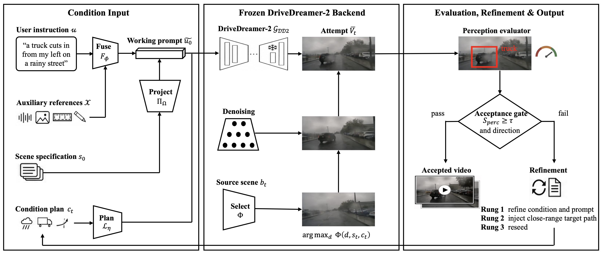
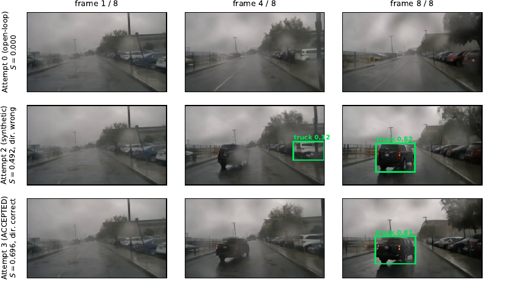
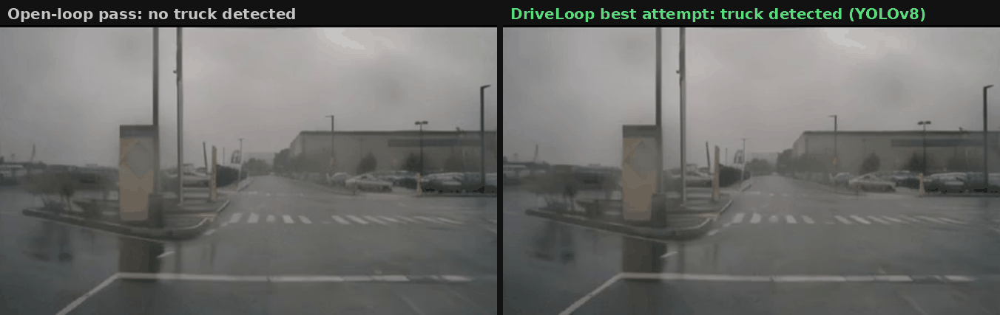
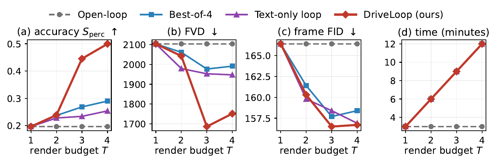

<div align="center">

# DriveLoop: Evaluation-Driven Closed-Loop Refinement for Driving Video Generation

</div>

DriveLoop (**evaluation-driven closed-loop refinement for driving video generation**) wraps a **frozen** [DriveDreamer-2](https://drivedreamer2.github.io) (DD2) backend in a closed loop of **generation, evaluation, diagnosis, and refinement**. Each attempt is rendered on a real nuScenes source scene and scored by a perception-oriented evaluator (with detector/tracker settings specified by each experiment protocol). Failed attempts descend a refinement ladder: strengthen structured conditions and refine the prompt text (Rung 1), inject a synthetic close-range trajectory of the requested category (Rung 2), and reseed (Rung 3). Keep-best selection preserves the maximum ranking score among evaluated candidates. Acceptance is checked separately; a higher-ranked candidate can fail the maneuver gate. An unaccepted fallback is not a successful video. The backend weights are never updated.



## Historical rainy-truck example

The original paper example requests a truck cutting in from the left on a rainy street. The figure illustrates the progression from an open-loop output to refinement attempts and the detector scores recorded for those attempts. Detector confidence and a proxy direction check alone do not establish that the requested maneuver or target identity is correct.



The animation below is a later demonstration, not the original A10 evidence or a replacement for its measurements:



## Historical main-paper results

- Mean perception score on seven backend arms: **0.208 → 0.533** (+156% over single-pass DD2), 32/35 configurations improve and 3 tie. These are seven backend arms with five requests each, not 35 independent source scenes.
- At the same 4-attempt budget, DriveLoop beats best-of-4 resampling by **73%** (0.533 vs 0.308).
- Reported distributional metrics: FID 166.4 → 156.7, FVD 2103 → 1752 against real nuScenes clips. These aggregate metrics do not certify maneuver correctness.
- One NVIDIA A10 (24 GB), fp16, about 3 minutes per attempt, roughly 12 minutes of generation for four attempts; this is not a strict end-to-end latency bound.

The archived budget curves summarize the original study:



These values are retained from the original experiment summaries. The separate pool study evaluated six cases; its launcher catalogs ten possible bindings. Complete original videos and attempt-level artifacts for the combined 41 historical cases have not been recovered, so this release does not claim complete independent reproduction of those results. Fixed seeds alone do not guarantee identical samples across hardware and software versions.

Later frozen evaluations, module ablations, input audits, and capture tools are supplementary material. They do not replace the historical main-paper experiments. See [release scope and supplementary reproduction dependencies](reproducibility/README.md).

## Repository layout

| Path | Contents |
| --- | --- |
| `driveloop/` | Core package: grounding, conditioning, source selection, DD2 backend adapter, evaluators, refiner, runner |
| `scripts/` | Experiment entry points (see below) |
| `tests/` | Unit and integration tests (`python -m pytest tests/`) |
| `experiments/` | Historical notes and acceptance-protocol documentation; not a complete raw evidence archive |
| `results/` | Paper data: per-attempt scores (`driveloop_plotdata.json`), metric curves (`measurement_curves.json`) |
| `reproducibility/` | Supplementary source snapshots and their provenance |
| `assets/` | README figures |
| `dreamer-datasets/`, `dreamer-models/`, `dreamer-train/` | DD2 runtime with input/capture/audit integration patches; released weights remain frozen |
| `DOCS/` | DD2 environment setup: `install.md`, `preparation.md`, `trainval.md` |

## Setup

1. Follow `DOCS/install.md` and `DOCS/preparation.md` to set up the DD2 runtime, released DD2 weights, and nuScenes v1.0-trainval.
2. Python environment: PyTorch with CUDA, `ultralytics` (YOLOv8), and the DD2 dependencies. Local paths are configured in `ENV.py`.

## Running

Single request through the full closed loop:

```bash
python scripts/run_driveloop_drivedreamer2.py
```

Historical experiment entry points (require the original data, paths, and protocol; running current code is not an exact replay of missing historical artifacts):

```bash
python scripts/run_seven_arms_v10f.py      # backend-arm study (7 arms x 5 requests)
python scripts/run_pool_v10f.py            # object x condition pool (10 bindings)
python scripts/run_family_comparison.py    # strategy comparison on the motorcycle family
python scripts/run_baseline_comparison.py  # open-loop / best-of-4 / text-only baselines
python scripts/run_fid.py                  # frame-wise FID vs real nuScenes clips
python scripts/run_fvd.py                  # FVD vs real nuScenes clips
python scripts/quality_gate.py             # joint acceptance gate readout
python scripts/summarize_closed_loop.py    # aggregate tables
```

Do not mix historical launchers, revised acceptance policies, and supplementary freezes when comparing results. Inspect the launcher configuration and output directory before starting a GPU job.

## Acceptance protocol revision (2026-10-05)

The generic runner now requires both score and diagnosis to pass. For the
paper's perception/direction gate, use `python -m scripts.render_window_case`
with the existing source/case arguments and
`--acceptance-policy joint_perception_direction --perception-acceptance-threshold 0.3`.
Add `--fixed-budget` for a full-budget experiment instead of early stopping.
Use a new output directory for each protocol and do not overwrite archived results.

`best_*` records the unconstrained score maximum. `returned_*` identifies the
actual output; `return_status` must be checked before treating it as accepted.
A missing direction measurement is not an automatic pass. The explicitly named
`legacy_score_or_diagnosis` mode is for historical replay only.
See [the protocol and theorem scope](experiments/2026-10-05_m1_acceptance_protocol.md).
The historical launchers and A10 figures above are not new joint-gate results.

## Tests

```bash
python -m pytest tests/test_joint_acceptance.py tests/test_runner_task_utility.py tests/test_frozen_eval.py
```

## Acknowledgements

The generation backend is [DriveDreamer-2](https://github.com/f1yfisher/DriveDreamer2) (AAAI 2025). We use the officially released weights without training updates. Runtime integration changes support conditioning, source binding, capture, and auditing. Source scenes come from the [nuScenes](https://www.nuscenes.org) dataset.

## License

Apache-2.0 (see `LICENSE`).
